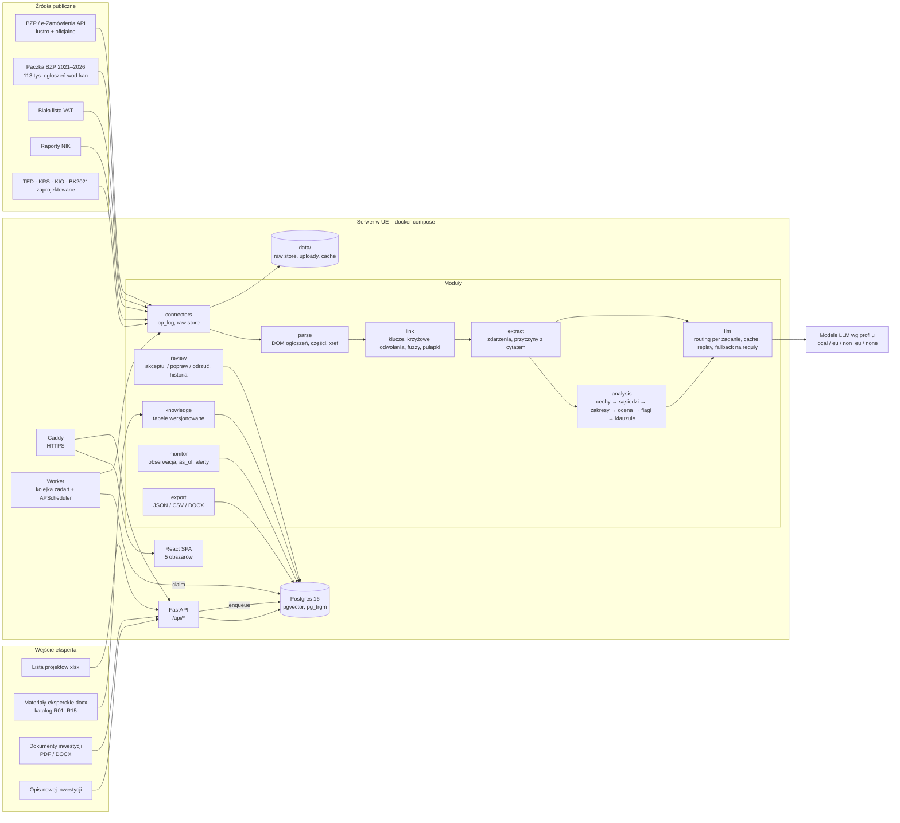

# Architektura – RISK MINER

Inteligentna baza doświadczeń inwestycji publicznych (pilotaż: gospodarka wodno-kanalizacyjna).
Jeden monolit modułowy (FastAPI + kolejka zadań w Postgresie) i SPA w React. Całość uruchamia `docker compose`
na jednym serwerze w UE.

## 1. Widok ogólny

## 2. Przepływy

**Ścieżka A – baza doświadczeń.** Import xlsx (każda komórka jako dowód) → wzbogacenie z BZP (zapytania po NIP
zamawiającego, filtrowanie po stronie klienta, bo API ignoruje TenderId/NIP) → parser DOM czterech typów ogłoszeń
→ łączenie projekt → postępowanie → umowa → zmiany (klucze, numery z sekcji 4.5, części, pułapki) → zdarzenia
regułowe + przyczyny z cytatem (art. 455) → kolejka przeglądu eksperta.

**Ścieżka B – nowa inwestycja.** Opis lub PDF/DOCX → cechy (podsektor, km, RLM, formuła, wartość) z dowodem →
podobne zakończone projekty z rozbiciem podobieństwa → zakresy odchyleń kosztu i czasu (n, przedział niepewności)
→ ocena budżetu i harmonogramu → flagi R01–R15 → rekomendowane działania i klauzule → rekordy do zatwierdzenia i
eksport.

**Monitoring.** Obserwowane postępowania (niezakończone inwestycje) → worker co 6 h pobiera nowe ogłoszenia →
alert + zlecenie ponownej analizy. Tryb `as_of` odtwarza historię („udawaj, że dziś jest data D”).

## 3. Zasady przekrojowe

| Zasada | Realizacja |
|---|---|
| Każdy fakt ma źródło | tabela `evidence`: źródło, trwały URL (ezamowienia.gov.pl, nie lustro), data pobrania, lokalizator (sekcja / strona / akapit / komórka), cytat; obliczenia: `derivation` (wejścia + wzór) |
| Ekspert decyduje | wszystko, co tworzy system, ma status `proposed`; ponowne przetwarzanie nigdy nie nadpisuje danych zatwierdzonych – zapisuje propozycję (`proposal`) do porównania; pełna historia w `review` |
| Idempotentność | identyfikatory uuid5 z kluczy naturalnych + upsert; drugi przebieg `riskminer demo` nie tworzy duplikatów |
| Integracje są audytowalne | każde zapytanie zewnętrzne w `op_log` (URL, parametry, kod, liczba wyników, czas); surowe odpowiedzi w `raw_record` |
| Długie operacje poza żądaniem HTTP | kolejka `job` (FOR UPDATE SKIP LOCKED), postęp i raport z przebiegu |
| LLM wymienny i opcjonalny | `llm.complete(task, …)` – łańcuch profili per zadanie, ostatni to `rules`; tryby live / cache / replay; treść dokumentów opakowana jako niezaufana; wynik oznaczony „Wniosek modelu” |
| Wiedza edytowalna | katalog R01–R15, podsektory, checklisty, wagi – generowane z docx eksperta do YAML i wersjonowane w `knowledge_table`; nowy sektor = nowe pliki |
| Skalowanie | dwa poziomy szczegółowości: `deep` (22 projekty, pełny łańcuch) i `auto` (tysiące postępowań z paczki BZP jako klasa referencyjna) |

## 4. Model danych

Pełny diagram ERD generowany z `backend/riskminer/models/tables.py`: [erd.md](erd.md) (`uv run riskminer docs-gen`).

Główne encje: `project` → `project_procedure` (powiązanie z metodą, pewnością i komponentami) → `procedure` (OCID)
→ `notice` (4 typy ogłoszeń, sekcje z offsetami) → `contract` → `contract_change` → `event` (R-kody, przyczyna,
skutek w dniach/PLN, środek zaradczy i jego skuteczność). Analizy: `analysis` → `analysis_item` (sąsiad, zakres,
ocena, flaga, działanie, klauzula – każdy z etykietą bloku). Operacje: `job`, `op_log`, `llm_call`, `alert`.

## 5. Stos i licencje

Backend: Python 3.12, FastAPI, SQLAlchemy 2, Alembic, psycopg 3, selectolax, pdfplumber/pypdf, python-docx,
scikit-learn, APScheduler. Frontend: React 19, TypeScript, Vite, Tailwind v4, TanStack Query/Router/Table,
React Flow, Recharts, pdf.js. Baza: Postgres 16 + pgvector. Proxy: Caddy 2.
Kod: Apache-2.0; bez zależności GPL/AGPL – zob. [LICENSES-THIRD-PARTY.md](../LICENSES-THIRD-PARTY.md).
Wdrożenie: [uruchomienie.md](uruchomienie.md).
