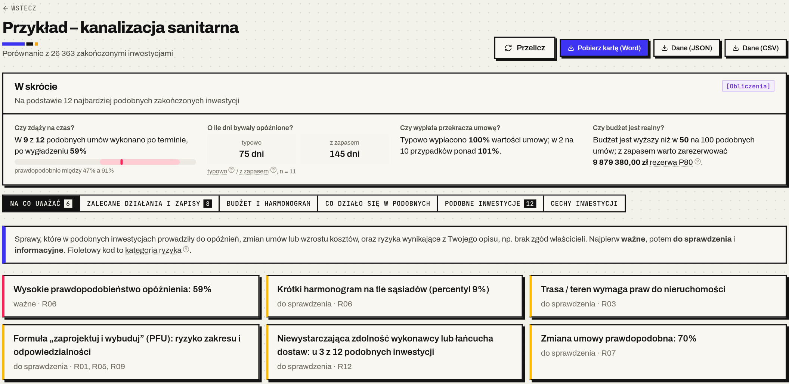
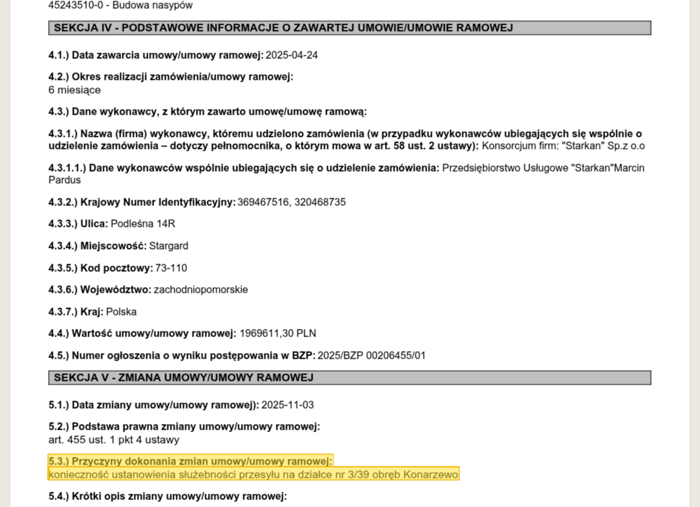

# RISK MINER – opis rozwiązania

*HackNation 2026 · zadanie Ministerstwa Funduszy i Polityki Regionalnej · pilotaż: gospodarka wodno-kanalizacyjna.*
*Limit: 10 stron. Wersja PDF: `docs/opis_rozwiazania.pdf` (pandoc / druk z przeglądarki).*

## 1. Problem i odbiorca (½ strony)

Instytucja zarządzająca i beneficjent planują inwestycję wod-kan, nie widząc doświadczeń podobnych inwestycji. Te
doświadczenia istnieją w danych publicznych: ogłoszenia o zmianie umowy (podstawa i przyczyna z art. 455), ogłoszenia
o wykonaniu umowy (termin, zapłacona kwota, liczba zmian), wyniki postępowań (liczba ofert, ceny), raporty NIK.
Brakuje powiązania ich z projektami, skategoryzowania (R01–R15) i udokumentowania, tak aby ekspert mógł
im zaufać.

W kopii BZP z lat 2021–2026 jest 39 094 umów wodno-kanalizacyjnych. 7 719 z nich (co piąta) ma ogłoszoną zmianę terminu, 8 665 zmianę wynagrodzenia, a 9 138 zmianę zakresu. Przyczyny są zapisane w tych ogłoszeniach i w protokołach, ale nikt ich nie łączy z projektami.

## 2. Rozwiązanie w skrócie (1 strona)

- **Baza doświadczeń (ścieżka A):** z listy projektów organizatora i BZP budujemy łańcuch projekt → postępowania →
  ogłoszenia → umowa → zmiany → zdarzenia → koszty i terminy → dokumenty, a każdy element ma dowód.
- **Analiza nowej inwestycji (ścieżka B):** z opisu lub dokumentu: podobne zakończone projekty z wyjaśnieniem,
  zakresy odchyleń kosztu i czasu z liczebnością próby i niepewnością, ocena budżetu i harmonogramu, flagi, działania
  i klauzule umowne. Wynik to rekordy do zatwierdzenia i eksportu (JSON/CSV/DOCX).
- **Kontrola eksperta:** nic nie jest „prawdą” bez akceptacji; korekty, odrzucenia, przepięcia powiązań i edycje
  wiedzy są wersjonowane i nie giną przy ponownym przetwarzaniu.
- **Monitoring (bonus):** obserwacja niezakończonych inwestycji, alert przy nowym ogłoszeniu, ponowna analiza, tryb
  odtwarzania historii `as_of`.

## 3. Co działa, a co jest zaprojektowane (1½ strony)

| Obszar | Działa (sprawdzone na danych) | Zaprojektowane, nie wdrożone |
|---|---|---|
| Import i źródła | plik xlsx organizatora z dowodem dla każdej komórki; BZP na żywo przez oficjalne API (156 zapytań, 952 ogłoszenia); kopia BZP 2021–2026 (113 tys. ogłoszeń, 45 tys. postępowań, 39 tys. umów, 27 tys. zmian); dziennik zapytań; ponowne pobranie bez duplikatów | TED, Biała lista VAT, KRS, KIO, BK2021, raporty NIK |
| Łączenie | po numerze KPO, numerze ogłoszenia, NIP, OCID i odwołaniach między ogłoszeniami; gdy brak klucza: nazwa, miejsce, CPV, data, wartość, z pewnością i listą warunków; 22/22 projektów zgodnie ze zbiorem wzorcowym | – |
| Zdarzenia i przyczyny | 104 zdarzenia dla 22 projektów: opóźnienia, zmiany umów, wypłaty ponad wartość, kary, powtórzone postępowania; przyczyny R01–R15 z cytatem (Bielik tylko z cytatem sprawdzonym w źródle) | – |
| Dokumenty | PDF z warstwą tekstową, DOCX, XLSX, CSV, HTML; protokoły i aneksy: nowy termin, koszt, przyczyna; sygnały ryzyka ze stroną lub akapitem; wyszukiwanie pełnotekstowe | OCR skanów (skan jest zapisywany i oznaczany do OCR) |
| Ekspert | kolejka „Do zatwierdzenia”, akceptuj / popraw / odrzuć / przepnij / wzorcowe, hurtowe zatwierdzanie pewnych pozycji, historia, decyzje odporne na przeliczenie; edytor wiedzy z wersjami | – |
| Nowa inwestycja | opis lub dokument → cechy z cytatem → 12 najbardziej podobnych z 26 tys. zakończonych umów → częstość i skala opóźnień, wypłata wobec umowy, ocena budżetu i harmonogramu z n i przedziałem → flagi R01–R15 → działania, zapisy umowne, wzorcowe przypadki → eksport Word, JSON, CSV | – |
| Monitoring | trwające inwestycje: alert o nowym ogłoszeniu i przekroczonym terminie, tryb `as_of` | ponowna analiza uruchamiana automatycznie po alercie |
| Modele i wdrożenie | Bielik 11B v3.0 lokalnie (Ollama), routing per zadanie, własny model w konfiguracji, same reguły bez modelu; docker compose | serwer z GPU na czas oceny ([hosting.md](hosting.md)) |

## 4. Pozyskanie i łączenie danych (1½ strony)

Skrót [zrodla_i_dopasowanie.md](zrodla_i_dopasowanie.md): źródła, dziennik zapytań, parser DOM, dopasowanie po kluczach i
kandydatach z oceną, części zamówień, pułapki.
Wyniki na zbiorze wzorcowym (z [raport_z_testu.md](raport_z_testu.md) §2): precyzja 1,0, kompletność 1,0; 22 powiązania poprawne, 0 niepewnych, 0 błędnych, 0 brakujących. 15 powiązań po identyfikatorze zatwierdził ekspert, 7 dopasowanych po podobieństwie czeka na jego decyzję.
Przykłady: Oława (pełny łańcuch), Biecz część 1, Nowogard (2 zmiany: R03 służebność, R02 warunki gruntowe),
Wolin RM-2026-022 (numer BZP z xlsx nie istnieje, powiązanie przez ogłoszenie o zmianie i pułapkę).

## 5. Zdarzenia, przyczyny i dokumenty (1½ strony)

- reguły na polach ogłoszeń (po terminie, zapłata powyżej wartości, zmiany terminu/wynagrodzenia/zakresu,
  unieważnienie, powtórzenie, jedna oferta, oferty powyżej budżetu);
- przyczyny zmian: reguły + model językowy z obowiązkowym cytatem sprawdzanym względem źródła;
- dokumenty PDF/DOCX: z protokołów konieczności i aneksów nowy termin, koszt robót dodatkowych i przyczyna z cytatem (np. Zławieś: termin z 30.10 na 05.12.2025, 151 481,54 zł); sygnały ryzyka ze stroną lub akapitem; lekcje NIK są zaprojektowane;
- skutek (dni, PLN, %), środek zaradczy i jego skuteczność.

Trafność klasyfikacji przyczyn zmian umów regułami (kod R01–R15 vs oznaczenie ręczne): zbiór wzorcowy 26 przyczyn: precyzja 0,87, kompletność 1,0, F1 0,93; zbiór kontrolny 32 przyczyn: precyzja 0,90, kompletność 0,84, F1 0,87. Bielik doprecyzowuje przyczyny tylko wtedy, gdy jego cytat zgadza się ze źródłem.

## 6. Analiza nowej inwestycji (2 strony)

Przebieg na fixture'ach z `backend/tests/fixtures/new_investments/` ([raport_z_testu.md](raport_z_testu.md) §5) i
przykładowy eksport [exports/przyklad/](../exports/przyklad/).

Źródło każdego faktu otwiera się w oryginale z podświetlonym fragmentem:

## 7. Kontrola eksperta i modułowość (1 strona)

Statusy, kolejka przeglądu, akceptacja hurtowa powiązań z kluczem, historia, propozycje przy ponownym przetwarzaniu,
edytor tabel wiedzy (import z docx eksperta → YAML → wersje w bazie), routing modeli per zadanie z miejscem
przetwarzania danych, rejestr konektorów (nowe źródło = nowa klasa), nowy sektor = nowe pliki wiedzy.

## 8. Architektura, wdrożenie, bezpieczeństwo (1 strona)

Skrót [architektura.md](architektura.md) i [uruchomienie.md](uruchomienie.md). Serwer w UE; LLM opcjonalny
(profile local / eu / non_eu / none); dane osobowe usuwane przed wysłaniem do modelu; treść dokumentów
traktowana jako niezaufana (test prompt injection); licencje bez GPL/AGPL ([LICENSES-THIRD-PARTY.md](../LICENSES-THIRD-PARTY.md)).

## 9. Ograniczenia i następne kroki (½ strony)

- dokumenty z platform zakupowych wymagają uploadu lub URL;
- małe n dla rzadkich podsektorów (pokazujemy to jawnie);
- pilotaż: wyciąg z CST2021 (NIP beneficjenta, daty) dla jednego programu i miesiąc pracy w jednej instytucji
  zarządzającej.
